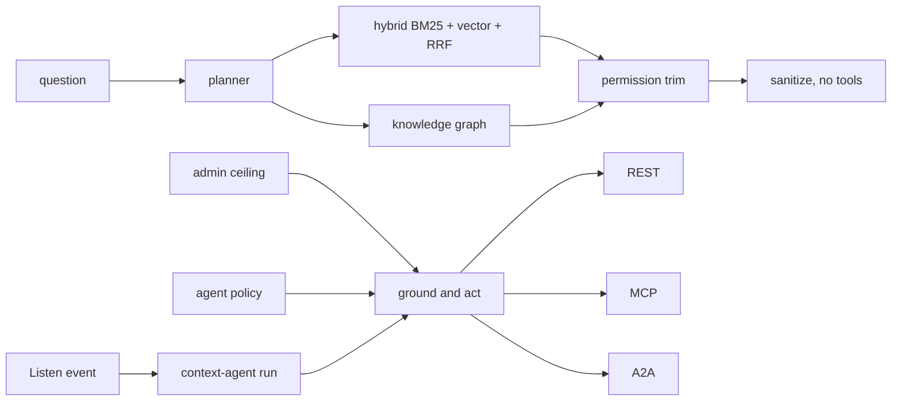

# Retrieval and grounding (`src/aiip/retrieval/`)

Hybrid retrieval compared with a knowledge-graph walk, permission-trimmed grounding, and one governed path over REST, MCP, and A2A. A Listen event starts a context-agent run. Offline fixtures only.

**Sections:** [1. Purpose](#1-purpose) · [2. Architecture](#2-architecture) · [3. How it works](#3-how-it-works) · [4. Key files](#4-key-files) · [5. Code excerpts](#5-code-excerpts) · [6. Configuration](#6-configuration) · [7. Commands](#7-commands) · [8. Real output](#8-real-output) · [9. Tests and eval gates](#9-tests-and-eval-gates) · [10. Guardrails](#10-guardrails) · [11. Security and governance](#11-security-and-governance) · [12. Observability](#12-observability) · [13. Failure modes](#13-failure-modes) · [14. Mapping to Azure services](#14-mapping-to-azure-services) · [15. Limitations](#15-limitations) · [16. Interview talking points](#16-interview-talking-points) · [17. Adopt this](#17-adopt-this)

## 1. Purpose

Show two grounding strategies on one corpus, then keep every read and write inside an admin ceiling and the caller's own access. The narrative, source links, and preview list are in [retrieval-and-grounding.md](../retrieval-and-grounding.md).

## 2. Architecture



## 3. How it works

1. `permissions.allowed` keeps a passage only when the caller matches its user, Entra group, or site group. A missing ACL fails closed. Confidential passages also fail closed until label policy is verified. That label check is public preview [verify].
2. Hybrid search ranks only the remaining passages: BM25, a hashing-trick vector that requires a shared token, then reciprocal rank fusion.
3. The graph walks two hops on edges whose cited documents are all readable. Topics are the fixture themes. GQL is one constrained `MATCH` statement. The graph and Microsoft Retriever 1 are public preview [verify]. The planner is a deterministic stand-in for Retriever 1, not that model.
4. `access.ground` and `access.act` apply the agent policy's domains, screen passage text, and audit the decision. REST, MCP, and A2A call those two functions.
5. The ceiling defaults to read, create, and update. Delete is denied. A proposed policy that adds a verb the ceiling lacks is rejected. Update on the care planner asks a person and does not write.
6. Listen sanitizes the event, then grounds as the user on the event. The raw text is not kept. Only `context-listen` may bind that user.

## 4. Key files

| File | What it does |
|---|---|
| `src/aiip/retrieval/corpus.py` | Synthetic passages, ACLs, entities, edges |
| `src/aiip/retrieval/hybrid.py` | BM25, hashing-trick vectors, RRF |
| `src/aiip/retrieval/graph.py` | Visible edges, two-hop answers, topics, GQL subset |
| `src/aiip/retrieval/permissions.py` | Fail-closed trim |
| `src/aiip/retrieval/governance.py` | Ceiling, policy, grants, audit |
| `src/aiip/retrieval/access.py` | Shared `ground` and `act` |
| `src/aiip/retrieval/rest.py` | REST, admin, Listen ingress |
| `src/aiip/retrieval/mcp_server.py` | MCP tools |
| `src/aiip/retrieval/handler.py` | A2A skills |
| `src/aiip/retrieval/listen.py` | Event to agent run |
| `evals/retrieval-cases.jsonl` | Comparison cases |
| `evals/retrieval-scores.json` | Latest comparison report |

## 5. Code excerpts

<!-- code: src/aiip/retrieval/permissions.py::allowed -->
```python
def allowed(passage: Passage, caller: Caller | None) -> bool:
    """True only when this caller may read this passage. None and a missing ACL are denials."""
    if caller is None or passage.acl is None:
        return False
    acl = passage.acl
    identity = caller.user in acl.users or bool(caller.entra & acl.entra) or bool(caller.sites & acl.sites)
    if not identity:
        return False
    if acl.container_readers and not (caller.container_roles & acl.container_readers):
        return False
    return passage.sensitivity != "confidential" or caller.label_policy_ok
```
<!-- /code -->

<!-- code: src/aiip/retrieval/hybrid.py::reciprocal_rank_fusion -->
```python
def reciprocal_rank_fusion(rank_lists: list[list[str]], k: int = RRF_K) -> list[tuple[str, float]]:
    """Fuse ranked id lists. Higher is better. Ties break on the id so the order is stable."""
    scores: dict[str, float] = {}
    for ranks in rank_lists:
        for rank, doc_id in enumerate(ranks, start=1):
            scores[doc_id] = scores.get(doc_id, 0.0) + 1.0 / (k + rank)
    return sorted(scores.items(), key=lambda item: (-item[1], item[0]))
```
<!-- /code -->

<!-- code: src/aiip/retrieval/governance.py::authorize -->
```python
def authorize(principal: Principal, verb: str) -> Decision:
    if verb not in VERBS:
        return Decision("block", E.VALIDATION, "unknown verb")
    if verb not in _ceiling:
        return Decision("block", E.AUTHZ_DENY, "above the admin ceiling")
    policy = _policies.get(principal.actor)
    if policy is None:
        return Decision("block", E.AUTHZ_DENY, f"no work policy for {principal.actor}")
    if verb not in policy.verbs:
        return Decision("block", E.AUTHZ_DENY, "outside this agent's policy")
    held = grants(principal.actor) | set(principal.roles) | set(principal.scopes)
    need = READ_GRANT if verb == "read" else ACT_GRANT
    if need not in held:
        return Decision("block", E.AUTHZ_DENY, f"missing {need}")
    if verb in policy.ask_on:
        return Decision("ask", E.APPROVAL_REQUIRED, "a person must confirm this action")
    return Decision("allow", E.OK, "within ceiling and agent policy")
```
<!-- /code -->

<!-- code: src/aiip/retrieval/access.py::caller_for -->
```python
def caller_for(principal: Principal, trusted_user: str | None = None) -> Caller:
    """The document subject. A body field cannot choose it.

    Only the Listen worker may bind the user named on an event. Everyone else is the user on
    the token, or, for an app-only token, a caller with no groups (fail closed).
    """
    if trusted_user is not None:
        if principal.actor != _LISTEN_ACTOR:
            raise E.GatewayError(E.AUTHZ_DENY, "only the listen worker may bind an event user")
        return DIRECTORY.get(trusted_user, Caller.empty(trusted_user))
    if not principal.is_user:
        return Caller.empty(principal.actor)
    username = principal.subject.split("@", 1)[0]
    return DIRECTORY.get(username, Caller.empty(username))
```
<!-- /code -->

## 6. Configuration

No new environment variables. The ceiling and policies live in process and reset between tests. Grants are the `WorkIQ.Read` and `WorkIQ.Act` app roles on `api://aiip-context-gateway` in `identity/registrations.py`. Olivia's `OpsApprover` role can change the ceiling. Alice's cannot.

Label verification defaults to off, so confidential passages stay hidden. That default matches fail-closed Purview behavior and is [verify] against the service.

## 7. Commands

```bash
pytest tests/test_39_retrieval_grounding.py -q
python scripts/run_retrieval_eval.py --check
python scripts/doc_retrieval.py
```

## 8. Real output

<!-- output: python scripts/doc_retrieval.py -->
```text
hybrid_multihop_recall=0.333
graph_multihop_recall=1.0
hybrid_loop_searches=4
hybrid_loop_recall=1.0
planned_searches=1
leaks=0
factual-returns chosen=hybrid hybrid=1.0 graph=1.0 leaked=[]
multihop-coating chosen=graph hybrid=0.333 graph=1.0 leaked=[]
broad-themes chosen=topics hybrid=1.0 graph=1.0 leaked=[]
sales-no-leak chosen=graph hybrid=1.0 graph=1.0 leaked=[]
listen outcome=grounded mode=graph docs=doc-agreement,doc-product,doc-regulation run=run-0001
```
<!-- /output -->

## 9. Tests and eval gates

`tests/test_39_retrieval_grounding.py` covers the comparison, the trim, injection withholding, the ceiling on REST, MCP, and A2A, policy proposals, the person-confirm path, and Listen. CI runs `python scripts/run_retrieval_eval.py --check`, which fails on a leak, a recall drop, or a stale `evals/retrieval-scores.json`.

## 10. Guardrails

- Hidden passages are removed before scoring, so they cannot change rank or appear in a dump.
- The question cannot name a different user. Only the Listen worker can bind an event user.
- Delete is above the default ceiling on every surface.
- An agent policy cannot outgrow the ceiling, and domains are an intersection with the caller's ACL.
- Event text is screened before it is used as a question. The audit stores a digest, not the text.

## 11. Security and governance

`WorkIQ.Read` and `WorkIQ.Act` are different grants. A sales policy cannot read HR even when the person could. Direct sign-in from a caller with no work policy is denied. MCP tools take no user argument. The A2A card rejects extra fields, including a `user` field.

## 12. Observability

Each decision appends actor, subject, operation, result, and an args digest to an in-process list. Passage text is not in that list. There is no workbook panel for this path yet.

## 13. Failure modes

| Situation | What happens |
|---|---|
| Passage has no ACL | Invisible |
| Confidential label, policy not verified | Withheld, count only [verify] |
| Verb above the ceiling | `authz_deny`, no write |
| Verb in `ask_on` | `approval_required`, no write |
| Instruction-like passage or event | Text replaced or the run outcome `withheld` |
| Unknown event type | No run |
| Event user not in the directory | `fail_closed`, no passages |

## 14. Mapping to Azure services

| Piece | Service |
|---|---|
| Hybrid rank | Azure AI Search hybrid query. Not connected |
| Graph, GQL, topics | Foundry IQ knowledge graphs, public preview [verify]. Not connected |
| Planner | Microsoft Retriever 1, public preview [verify]. Not connected |
| User, group, and site trim | Foundry IQ SharePoint permissions. Fixture ACLs, not SharePoint |
| Confidential passages | Purview sensitivity labels, public preview [verify] |
| REST, MCP, A2A, ceiling, Listen | Work IQ. Not connected. Listen is not wired to the SAP Event Gateway |

## 15. Limitations

- Nothing here has been called against Azure AI Search, Foundry IQ, SharePoint, Purview, or Work IQ.
- The vector channel cannot match a paraphrase that shares no tokens. Semantic ranker quality is not measured.
- Topics are labels on the fixtures. Automatic topic discovery is [verify] and not built.
- GQL is a subset: one name filter, `->` and `<-`, and `var.name` in the return list.
- The context agent is in-process. It is not in the 15-process demo and not in the Bicep or Terraform workload list.
- Word, Excel, and PowerPoint editing, ERP and Engage preview data, OneLake item permissions, and provenance signals are [verify] and not built.

## 16. Interview talking points

- Trim first, then rank. A forbidden passage must not affect the score.
- One function for REST, MCP, and A2A, so the ceiling cannot drift between them.
- The graph wins the multi-hop fixture because the agreement and the regulation share no tokens. The product claim that Retriever 1 uses fewer searches is [verify]; the stand-in shows the shape of that plan.
- Listen is an event, not a poll, and it still cannot delete or read outside the worker policy.

## 17. Adopt this

1. Add passages with an ACL, or leave the ACL empty to prove they stay hidden.
2. Add edges only with the document ids that justify them.
3. Widen the ceiling before a policy may use a new verb.
4. Run `python scripts/run_retrieval_eval.py` and commit `evals/retrieval-scores.json`.
