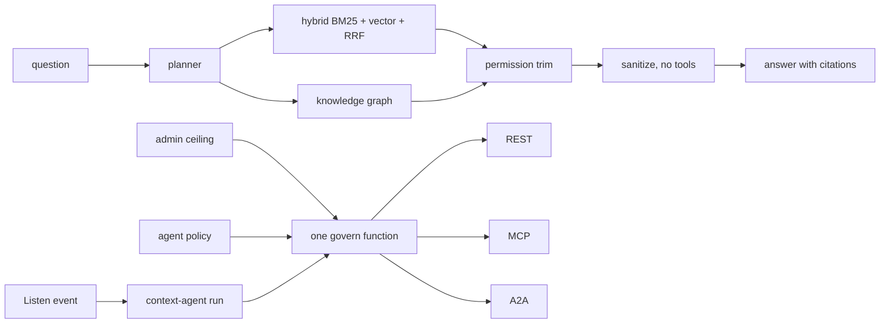

# Retrieval and grounding

Two ways to ground an agent on the same synthetic corpus, then one governed path for reading and acting. Everything runs offline. Azure AI Search, Foundry IQ, SharePoint, and Work IQ are not connected.

Sources:

- [Foundry IQ: knowledge graphs engineered for agents](https://techcommunity.microsoft.com/blog/azure-ai-foundry-blog/foundry-iq-introducing-knowledge-graphs-engineered-for-agents/4572683)
- [What's new in Work IQ at Ignite 2026](https://techcommunity.microsoft.com/blog/microsoft_365blog/whats-new-in-work-iq-at-ignite-2026-agents-that-get-work-done/4572219)



## Hybrid retrieval and the knowledge graph

The hybrid path is the Azure AI Search shape: BM25, a vector channel, and reciprocal rank fusion with k=60. The vector channel is a hashing trick. It scores a passage only when the passage shares a token with the question, so this comparison does not claim semantic-ranker quality.

The graph path follows Foundry IQ knowledge graphs, which are in public preview [verify]. Entities and edges come from a fixed ontology on the fixture corpus. Each edge keeps the document ids that justify it, and the edge is invisible unless the caller can read every cited document. A natural-language question walks two hops. A small GQL subset answers one `MATCH ... WHERE name = '...' RETURN` pattern. Topics are the themes declared on the fixtures. Automatic topic discovery, and a model that proposes an ontology, are public preview [verify] and are not implemented.

The planner is a stand-in for Microsoft Retriever 1, also public preview [verify]. A regulation-shaped question uses the graph. A theme question uses topics. Anything else is one hybrid query.

On the fixture question "What must we do about regulation EU-COATING-2026?":

| Path | Supporting documents recalled | Searches |
|---|---|---|
| Hybrid, one query | the regulation only (recall 0.333) | 1 |
| Hybrid loop that reads entity names and searches again | regulation, product sheet, and agreement | 4 |
| Graph, one planned query | regulation, product sheet, and agreement | 1 |

The agreement never shares a token with that question. The graph still reaches it because the regulation restricts Zinc-X, Bolt-07 uses Zinc-X, and agreement C-14 lists Bolt-07. A factual question about damaged goods is answered by both paths. Scores are in `evals/retrieval-scores.json`. They measure this code, not a live index.

## Permission-trimmed grounding

Before either ranker scores a passage, the caller is matched to the passage ACL. A match is an explicit user, an Entra group, or a SharePoint-style site group. A missing ACL fails closed. A container reader role is required when the passage sets one. A confidential passage is withheld unless label policy has been verified. That label check stands in for Purview sensitivity-label enforcement, which is public preview [verify]. The withheld count is returned without titles or text.

The caller's groups come from the token's user, not from a field in the question. An app-only token has no groups, so it sees nothing. Only the Listen worker may bind the user named on an event.

Agent policy is a second cut. A sales agent does not receive HR passages even when the signed-in person could open them, and an HR agent does not receive them for a person who is not in the HR group.

Returned text is screened with the repo's untrusted-content screen, which has no tools. The product describes an isolated model for that step. Offline, the regex screen is the stand-in, and the isolated model is [verify].

## One governed path

REST (`POST /v1/ground`, `POST /v1/act`), the MCP tools `ground_question` and `act_on`, and the A2A skills on `context-agent` all call `access.ground` and `access.act`.

The admin ceiling is the upper bound. The default is read, create, and update. Delete is refused on every surface, and the work item is left as it was. An agent policy may use fewer verbs and may name data domains. Saving a policy that adds a verb the ceiling does not allow is rejected. `WorkIQ.Read` and `WorkIQ.Act` are separate grants. Update on the care planner stops for a person (`approval_required`) and does not write.

Listen subscribes to `com.contoso.work.message.received.v1`. A matching event starts one context-agent run: sanitize the text, plan, then ground as the event's user. The raw text is stored only as a digest. An injected instruction never becomes the question. A SAP order event does not start a run. The worker's policy still cannot read HR, and the run cannot delete.

## Preview items

These are marked [verify] because they are preview, not yet shipped, or only described. This repo does not call them.

- Foundry IQ knowledge graphs, including GQL and bringing an existing graph [verify]
- Microsoft Retriever 1 [verify]
- Automatic topics and a candidate ontology from embeddings [verify]
- Purview sensitivity-label enforcement [verify]
- OneLake item permissions, and Fabric IQ knowledge sources [verify]
- Foundry IQ in every new project, and the Foundry IQ Serverless production SLA [verify]
- Work IQ Business Applications ERP, and Engage [verify]
- Creating or editing Word, Excel, and PowerPoint content [verify]
- Provenance signals on retrieved content [verify]
- The isolated sanitizer model [verify]

SharePoint permission trimming, source ACLs on supported stores, and Work IQ over MCP, REST, and A2A are described as generally available. The code here is the pattern on fixtures, not a connection to those services.

## Run

```bash
pytest tests/test_39_retrieval_grounding.py -q
python scripts/run_retrieval_eval.py --check
```

The context agent is in-process. It is not one of the demo's 15 processes and it is not a Container App in the Bicep or Terraform.
